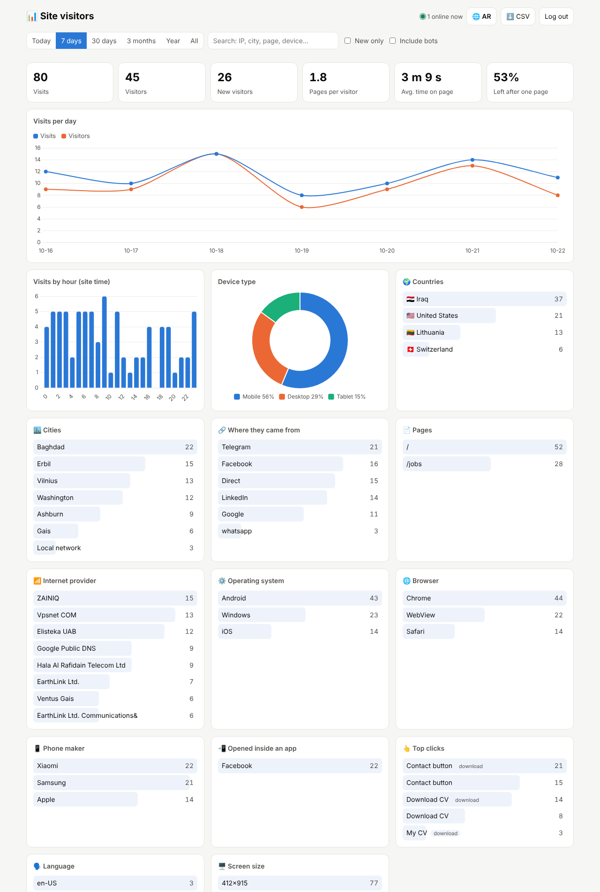
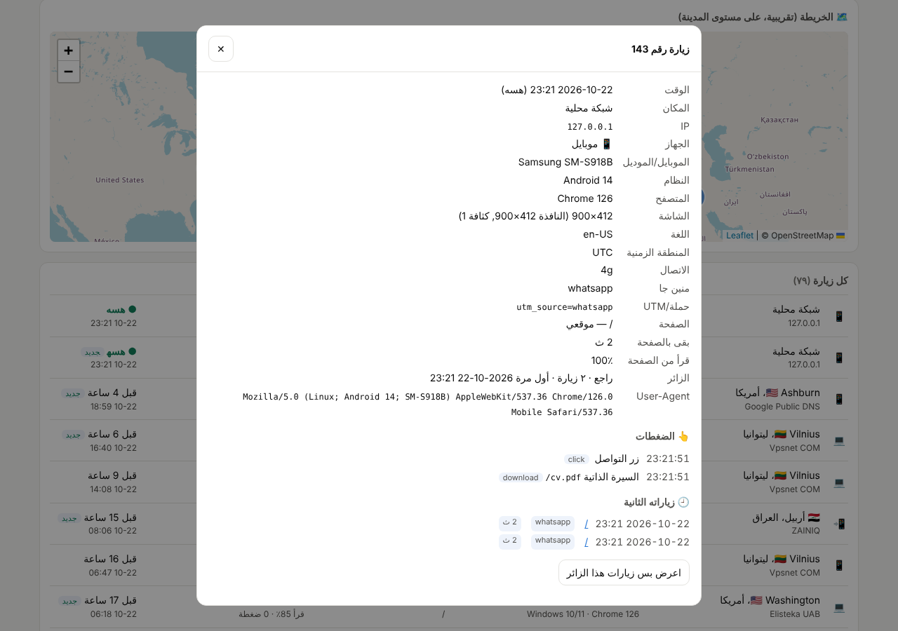

# visitor-dashboard

A password-protected page you add to any Python website (Flask or Django) in two lines. It shows every visit with
its details, plus charts. No AI, no paid service, no tracking company: the data stays on your server in one SQLite file.



## What it records about each visit

| | Details |
|---|---|
| 🕐 **When** | Date and time in your time zone, time spent on the page, and how far down the page was read (%) |
| 📱 **Device** | Phone, computer or tablet; maker and model (Samsung SM-A515F, iPhone…); OS and version; browser; screen size; language; connection type (4g…); dark mode |
| 🌍 **Where** | Country, region and city; internet provider (Earthlink, Zain, Asiacell…); approximate coordinates on a map |
| 🔗 **Origin** | Google, Facebook, Telegram, WhatsApp, LinkedIn, X, direct, or any other site. Reads `utm_source` and `?ref=` too |
| 📲 **In-app** | Whether the link was opened inside an app (Facebook, Instagram, TikTok, Telegram…) |
| 👆 **Clicks** | Every button and link clicked, downloads (PDF…), and contact links (WhatsApp, Telegram, email) |
| 👤 **Visitor** | New or returning, number of visits, first seen, and all their earlier visits |
| 🤖 **Bots** | Googlebot, link previews (WhatsApp, Telegram, Facebook) and scripts are kept apart from real visitors |

## The dashboard

- Headline numbers: visits, visitors, new visitors, pages per visitor, average time spent, bounce rate, and **who is online now**
- Charts: visits and visitors per day, visits by hour, device type, countries, cities, internet providers, pages,
  origins, operating systems, browsers, phone makers, in-app browsers, top clicks, languages, screen sizes, and a map
- **Click to filter**: click any country, city, origin or device and the whole dashboard filters to it; filters combine
- Time ranges (today, 7 days, 30 days, 3 months, a year, all) and search by IP, city, page or device
- A list of every visit; click one to see all its details, its clicks, and the same person's other visits



- Refreshes itself every 20 seconds; export to Excel (CSV)
- Works on phones and in dark mode; the interface is in Arabic (right-to-left)

## Install

```bash
pip install "visitor-dashboard[flask] @ git+https://github.com/Thanoon12k/visitor-dashboard"
# or, for a Django site:
pip install "visitor-dashboard[django] @ git+https://github.com/Thanoon12k/visitor-dashboard"
```

### Flask

```python
from visitor_dashboard.flask import VisitorDashboard

VisitorDashboard(app, password="your secret code")
```

### Django (`settings.py`)

```python
MIDDLEWARE = ["visitor_dashboard.django.VisitorDashboardMiddleware", *MIDDLEWARE]  # first
VISITOR_DASHBOARD = {"password": "your secret code"}
```

That's it. Open `https://your-site/visits` and enter the code. Every HTML page your site sends is counted
automatically; your templates don't change.

> Don't write the code in your source: keep it in an environment variable, e.g. `password=os.environ["VISITS_PASSWORD"]`.

## Options (all optional except the password)

| Option | Default | What it does |
|---|---|---|
| `password` | | The dashboard's secret code. Without it the dashboard stays locked (recording still works) |
| `prefix` | `/visits` | The dashboard's address |
| `db_path` | `instance/visits.db` (Flask), `BASE_DIR/visits.db` (Django) | Where visits are saved |
| `tz` | `Asia/Baghdad` | Time zone for display |
| `telegram` | | `(token, chat_id)`, or a function returning them, to get a message from your bot |
| `notify` | `"new"` | `"new"`: a message for each new visitor, `"all"`: for every visit, `"off"`: none |
| `notify_limit` | `20` | Most messages per hour |
| `exclude_ips` | `()` | IP addresses that are never counted |
| `ignore` | `()` | Path prefixes that are never counted, e.g. `("/admin", "/api")` |
| `geo_dir` | | Folder with the location database (see below) |
| `geo_online` | `True` | Look places up online when there is no database |
| `keep_days` | | Delete visits older than this many days |
| `title` | `زوّار الموقع` | The dashboard's title |

### Leave out your own visits

When you log in, keep "don't count my visits from this device" ticked, and visits from that browser are no longer
counted. Do it once on each of your devices.

### Telegram notifications

```python
VisitorDashboard(app, password="...", telegram=(os.environ["BOT_TOKEN"], os.environ["CHAT_ID"]))
```

For each new visitor (bots excluded) you get the country, city and provider, the device and model, where they
came from, the page, and a link to the visit's details.

### Click tracking

Buttons and links are tracked automatically by their visible text. To name one yourself:

```html
<button data-track="Subscribe button">Subscribe</button>
```

## Locations: online or from a file

By default places come from [ip-api.com](https://ip-api.com) (free), falling back to [ipwho.is](https://ipwho.is).
Each IP is looked up only once, and only after the visit is saved, so visitors never wait.

If your server can't reach those services (PythonAnywhere's free plan, for example, only allows certain sites),
download the free database once:

```bash
pip install maxminddb
python -m visitor_dashboard geo-download ~/geo            # cities + providers (~140 MB)
python -m visitor_dashboard geo-download ~/geo --country  # countries + providers only (~17 MB)
```

Then pass `geo_dir="~/geo"`. The files come from [DB-IP](https://db-ip.com) (CC BY 4.0) and are updated monthly,
so download them again every few months.

> A location from an IP address is approximate (city level) and not always right, especially on mobile networks
> (a visitor may show up in Baghdad while in another city) or behind a VPN.

## Privacy and security

- The password is compared in constant time, and 5 wrong tries in 15 minutes lock out that IP.
- The login session is a signed cookie (30 days), ended by the logout button.
- Reports from the browser are signed with a random key per visit, so nobody can alter someone else's visit.
- The script sets no cookies of its own; the site sets one cookie (`vd_id`) to recognise returning visitors.
- If your site serves people in Europe or anywhere with privacy laws, publish a privacy policy that says you log visits.

## Tests

```bash
pip install -e ".[test]"
pytest
```

License: MIT
